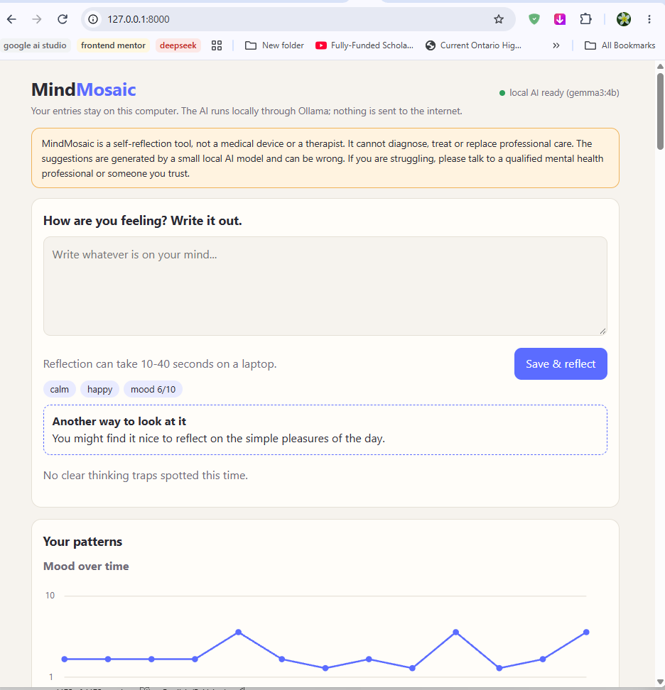
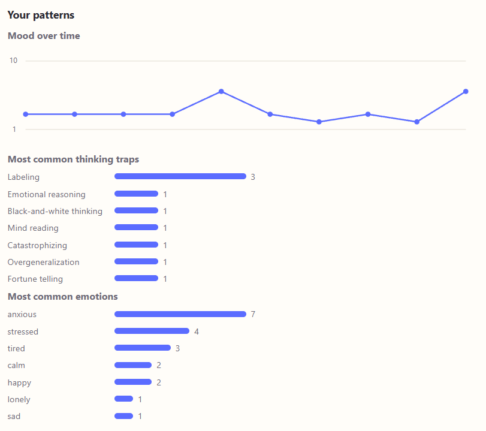

# MindMosaic: a private CBT journal



*MindMosaic view and interface.*


*Mood over time and most common thinking traps.*

> **Your private thoughts never leave your device.**
> A local-first journaling app that notices unhelpful thinking patterns and gently offers CBT-style alternative perspectives, using an open-weight Gemma model running on your own computer.

## The problem
Many people use journaling to cope with stress and anxiety, but a blank page doesn't tell you *how* you are thinking. Cognitive Behavioral Therapy (CBT) teaches that certain thinking traps (like catastrophizing or all-or-nothing thinking) make distress worse, and that spotting them helps. Therapy is not accessible to everyone, and mental-health writing is among the most sensitive data a person has, so sending it to a cloud AI is a real privacy concern.

**MindMosaic** gives people a private space to write, helps them notice their own thinking traps, and tracks patterns over time, all without their words leaving their device.

## Features
- **Journal entries** stored locally in SQLite
- **Thinking-trap detection** for 10 common cognitive distortions (catastrophizing, black-and-white thinking, mind reading, fortune telling, overgeneralization, emotional reasoning, should statements, labeling, personalization, discounting the positive)
- **Gentle reframing:** fixed Socratic CBT questions per distortion, plus one short, tentative alternative thought
- **Mood and emotion tracking** with a mood-over-time chart and counts of your most common traps and emotions
- **Safety layer:** crisis wording is caught before the AI is used and replaced with a supportive message pointing to real help
- **Privacy controls:** export all data to JSON, delete one entry or everything
- **Works offline:** if the AI isn't running, entries are still saved

## How AI is used
AI is central: the app's main value, spotting thinking traps in free-form writing, needs language understanding.

| Step | Who does it |
|---|---|
| Estimate mood and emotions from the text | **Gemma** (local, via Ollama) |
| Pick which distortions appear, quoting the user's own words | **Gemma**, limited to a fixed list of IDs |
| Write one short, tentative alternative thought | **Gemma** |
| Distortion names, explanations, Socratic questions | **Fixed CBT templates** in `app/cbt.py` |
| Crisis detection | **Rule-based check** that runs *before* any model call |

Guardrails around the model:
- Output is requested as structured JSON (Ollama structured outputs) and validated
- Unknown distortion IDs are dropped
- Quotes that don't appear in the entry are discarded, so the model can't invent evidence
- Low temperature (0.2) for consistent output
- The model is never asked to diagnose or give medical advice, and a disclaimer is always shown
- The wording-cue check for Labeling, Overgeneralization and Should statements, and the rule that the alternative thought may only use facts from the entry.

## Open-source tools used
- [Gemma](https://ai.google.dev/gemma) (Google's open-weight models), `gemma3:4b` by default
- [Ollama](https://ollama.com) to run the model locally
- [FastAPI](https://fastapi.tiangolo.com) + Uvicorn for the backend
- SQLite for local storage
- Plain HTML/CSS/JS for the UI (no external services or CDNs)
- pytest for tests

## Setup
**Requirements:** Python 3.10+, [Ollama](https://ollama.com/download), about 4 GB of free RAM for the default model.

1. Pull a Gemma model:
   ```
   ollama pull gemma3:4b
   ```
   (Use `gemma3:1b` on low-RAM machines or `gemma3:12b` for better quality.)
2. Install and run:
   ```
   python -m venv .venv
   source .venv/bin/activate        # Windows: .venv\Scripts\activate
   pip install -r requirements.txt
   python -m uvicorn app.main:app --host 127.0.0.1 --port 8000
   ```
3. Open http://127.0.0.1:8000. The dot in the top corner turns green when the local model is ready. 
“If you get a CUDA error, run Ollama on CPU: set CUDA_VISIBLE_DEVICES=-1 then ollama serve.”

Change the model with an environment variable, e.g. `MINDMOSAIC_MODEL=gemma3:1b` (PowerShell: `$env:MINDMOSAIC_MODEL="gemma3:1b"`). Ollama is expected at `http://localhost:11434`; override with `OLLAMA_URL`.

## Tests
```
pytest -q
```
The tests cover crisis detection, output validation, the skip-the-model crisis path, the full flow, and the offline fallback. The model is mocked, so they run without Ollama.

## Project layout
```
app/safety.py     disclaimer + crisis detection
app/cbt.py        distortion templates, prompt, Ollama client, output validation
app/db.py         SQLite storage and insights
app/main.py       FastAPI routes
app/static/       single-page UI
tests/            pytest suite
docs/EXPERIMENTS.md   experiment log and design decisions
```

## Limitations and safety notes
- **Not a medical device or therapist.** It cannot diagnose or treat anything. If you are struggling, please talk to a qualified professional or someone you trust.
- **In crisis?** Contact your local emergency number, or find a helpline at https://findahelpline.com.
- Small local models make mistakes. Suggestions are prompts for reflection, not conclusions.
- Crisis detection is keyword-based and can miss indirect wording. It is a safety net, not a guarantee.
- The database is a plain SQLite file in `data/`. Anyone with access to your computer account can read it (encryption is a planned improvement).
- Tested with gemma3:4b only”

## License
[MIT](LICENSE)


